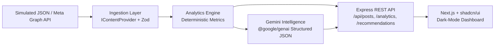

# Instagram Content Intelligence System (ICIS)

An end-to-end content analytics and AI strategy engine built for the **AITL Software Engineering Recruitment Challenge**. ICIS ingests Instagram post performance data through an extensible provider interface, computes deterministic engagement metrics, and uses the **Gemini API (`@google/genai`)** with strict Structured Outputs to generate evidence-backed content recommendations.

> **Video Walkthrough (Deliverable #5):** `[Add 5–10 Minute Demo Video Link Here Before Submission]`

---

## Key Capabilities

* **Extensible Data Ingestion (`IContentProvider`):** Decouples data collection from analytics and AI logic. Ships with `SimulatedInstagramProvider` (60 realistic posts across Reels, Carousels, and Static Images) alongside a typed `InstagramGraphProvider` adapter ready for live Meta Graph API integration.
* **Deterministic Performance Analysis Engine:** Calculates Weighted Engagement Rate, format lift (`REEL` vs. `CAROUSEL` vs. `IMAGE`), topic performance, temporal posting trends (day-of-week & hour buckets), caption hook impact, and Top 5 vs. Bottom 5 rankings using pure, unit-tested TypeScript functions.
* **Data-Grounded Gemini Strategist:** Feeds pre-aggregated statistical summaries into `gemini-2.5-flash` using Zod-enforced JSON schemas so every content recommendation cites real `postId`s and exact metrics from the dataset rather than generic advice.
* **Minimal Functional Dashboard:** A dark-mode Next.js + `shadcn/ui` interface focused on data clarity, filtering, and one-click strategy generation.

---

## System Architecture



### Core Engineering Decisions
1. **Preventing LLM Hallucinations:** LLMs do not compute raw statistics. The deterministic analytics engine aggregates all ratios and rankings first; Gemini only synthesizes strategy from verified metrics and must pass Zod post-validation confirming cited `postId`s exist.
2. **Weighted Engagement Rate Formula (Uniform Cross-Format Scale):**
   $$\text{Weighted Engagement Rate} = \left(\frac{\text{Likes} + (3 \times \text{Comments})}{\text{Reach}}\right) \times 100$$
   - **Uniform Denominator (`reach`):** `reach` (unique accounts reached) is available across all media types (`REEL`, `CAROUSEL`, `IMAGE`), ensuring an apples-to-apples comparison on the exact same scale without metric distortion.
   - **Comment Weighting ($3\times$):** Comments receive a $3\times$ multiplier reflecting active cognitive investment and algorithmic ranking weight over passive double-taps.
   - **Decoupled Video Metrics:** `views` is preserved as a video-specific metric for Reels (evaluating $\text{replayRatio} = \text{views} / \text{reach}$) rather than distorting the cross-format engagement denominator.
   - **Uniform Fallback (`ACCOUNT_FOLLOWER_COUNT`):** If an external provider lacks `reach`, `ACCOUNT_FOLLOWER_COUNT` is applied uniformly to all formats.

---

## Tech Stack

| Layer | Technologies |
| :--- | :--- |
| **Backend API** | Node.js, Express, TypeScript, Zod |
| **AI Intelligence** | Google Gemini API (`@google/genai`, `gemini-2.5-flash`, Structured Outputs) |
| **Frontend UI** | Next.js (App Router), TypeScript, Tailwind CSS, `shadcn/ui` |
| **Testing & CI** | Vitest, Supertest, GitHub Actions |

---

## Repository Structure

```text
icis-content-intelligence/
├── .agents/rules/          # Antigravity IDE verification & architectural guardrails
├── .github/workflows/      # GitHub Actions CI pipeline (build + Vitest)
├── backend/
│   ├── data/               # 60-post simulated Instagram dataset (sample_posts.json)
│   ├── src/
│   │   ├── analytics/      # Pure deterministic metrics & trend engine
│   │   ├── config/         # Zod-validated environment configuration
│   │   ├── ingestion/      # IContentProvider, Simulated & Graph API providers
│   │   ├── intelligence/   # Gemini Structured Output service
│   │   ├── routes/         # Express REST endpoints
│   │   └── schemas/        # Shared Zod schemas & inferred types
│   └── tests/              # Vitest unit & Supertest API integration suites
├── docs/
│   ├── ARCHITECTURE.md     # Detailed system design, trade-offs & v2 roadmap
│   ├── PRD.md              # Product requirements & metric definitions
│   ├── ai-logs/            # AI agent task delegation, bug investigation & verification logs
│   └── eod-reports/        # Daily development progress reports
├── frontend/               # Next.js + shadcn/ui dashboard
├── GEMINI.md               # Root AI workspace context & coding standards
└── README.md
```

---

## Getting Started

### Prerequisites
* **Node.js** v20+ and **npm** v10+
* A **Google Gemini API Key** (from Google AI Studio)

### 1. Backend Setup (`http://localhost:4000`)

```bash
cd backend
npm install
```

Create `backend/.env` using the root `.env.example` template:

```env
PORT=4000
GEMINI_API_KEY=your_gemini_api_key_here
ACCOUNT_FOLLOWER_COUNT=10000
```

Start the Express development server:

```bash
npm run dev
```

Run the automated test suite and TypeScript build check:

```bash
npm test
npm run build
```

### 2. Frontend Setup (`http://localhost:3000`)

Open a second terminal at the repository root:

```bash
cd frontend
npm install
```

Create `frontend/.env.local`:

```env
NEXT_PUBLIC_API_URL=http://localhost:4000/api
```

Start the Next.js dashboard:

```bash
npm run dev
```

Open **`http://localhost:3000`** in your browser.

---

## API Reference

| Method | Endpoint | Description |
| :--- | :--- | :--- |
| `GET` | `/api/health` | Service health and active provider check |
| `GET` | `/api/posts` | Returns normalized Instagram posts (`?postType=` and `?topic=` filters supported) |
| `GET` | `/api/analytics` | Computes and returns full engagement, format, topic, and temporal analytics |
| `POST` | `/api/recommendations` | Runs analytics and invokes Gemini to return structured, post-cited content recommendations |

---

## Documentation & Engineering Artifacts

* **[Product Requirements Document (`docs/PRD.md`)](docs/PRD.md)** — Functional specs, metric definitions, and edge cases.
* **[Architecture & Technical Decisions (`docs/ARCHITECTURE.md`)](docs/ARCHITECTURE.md)** — Provider extensibility, hallucination guardrails, and v2 roadmap.
* **[AI Agent Logs (`docs/ai-logs/`)](docs/ai-logs/)** — Guardrails established, tasks delegated to Antigravity IDE, bugs caught in agent output, and test verification transcripts.
* **[End-of-Day Reports (`docs/eod-reports/daily-updates.md`)](docs/eod-reports/daily-updates.md)** — Daily progress updates, blockers, and reflections.