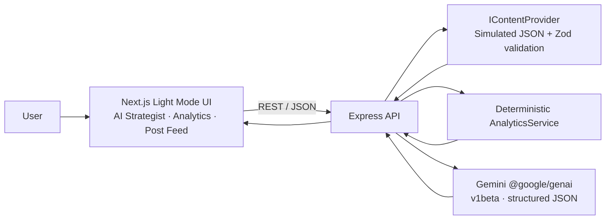

# Instagram Content Intelligence System (ICIS)

ICIS analyzes Instagram post performance and turns deterministic analytics into
evidence-backed content recommendations. It is a prototype built for the AITL
Software Engineering Recruitment Challenge, with an extensible content-provider
interface and an interactive Next.js dashboard.

> **Walkthrough video:** [Add 5–10 minute demo video link here before submission]

## Features

- **Three workspace views:** AI Strategist, Performance Analytics, and Post Feed.
- **Post Feed:** Search captions and post IDs, filter by format or topic, and
  inspect dense post-level performance.
- **Slide-over post inspector:** Open posts from the feed, analytics rankings, or
  AI recommendation citations to see captions, metrics, and the WER calculation.
- **Command menu:** Press `⌘K` on macOS or `Ctrl+K` on Windows/Linux to switch
  views, filter formats, and generate a strategy.
- **Deterministic analytics:** Compare Reels, Carousels, and Images using
  reach-normalized engagement; explore topics, caption hooks, posting windows,
  and top/bottom post rankings.
- **AI content strategy:** Gemini synthesizes verified analytics into
  recommendations with exact evidence and citations to real post IDs.
- **Light Mode UI:** Next.js App Router, TypeScript, Tailwind CSS, shadcn/ui, and
  Motion.

## Architecture



The backend separates ingestion, deterministic analytics, AI synthesis, and
HTTP routing. The active `SimulatedInstagramProvider` reads 60 sample posts;
the `InstagramGraphProvider` is currently a stub, not a live Meta integration.
WER uses the same reach denominator across formats:
`((likes + 3 * comments) / reach) * 100`. Reel `replayRatio` is computed
separately as `views / reach`. Gemini receives deterministic summaries, returns
structured JSON, and its response is checked with Zod, including validation
that every cited post ID exists in the source dataset.

See [docs/ARCHITECTURE.md](docs/ARCHITECTURE.md) for layer boundaries,
mathematical details, hallucination safeguards, and the production roadmap.

## Tech stack

| Layer | Technologies |
| --- | --- |
| Frontend | Next.js App Router, TypeScript, Tailwind CSS, shadcn/ui, Motion |
| Backend | Node.js, Express, TypeScript, Zod |
| Intelligence | `@google/genai`, Gemini 2.5 Flash, structured JSON output |
| Tests | Vitest, Supertest |

## Prerequisites

- Node.js 20+ and npm 10+
- A Gemini API key from Google AI Studio to generate recommendations

## Getting started

Install dependencies from the repository root in each project:

```powershell
cd backend
npm install
```

Create `backend/.env` (do not commit API keys):

```env
PORT=4000
NODE_ENV=development
GEMINI_API_KEY=your_gemini_api_key_here
GOOGLE_GENAI_API_VERSION=v1beta
ACCOUNT_FOLLOWER_COUNT=10000
```

Start the backend:

```powershell
npm run dev
```

In a second terminal, install frontend dependencies:

```powershell
cd frontend
npm install
```

Create `frontend/.env.local`:

```env
NEXT_PUBLIC_API_URL=http://localhost:4000/api
```

Start the frontend on port 3000:

```powershell
npm run dev
```

Open [http://localhost:3000](http://localhost:3000). The dashboard and
deterministic analytics work with the simulated provider; AI strategy
generation requires a valid `GEMINI_API_KEY`.

### Environment variables

| Variable | Project | Purpose |
| --- | --- | --- |
| `GEMINI_API_KEY` | Backend | Google Gemini API key. Required for live AI strategy generation. |
| `GOOGLE_GENAI_API_VERSION` | Backend | Google GenAI API version. Use `v1beta` for structured output. |
| `NEXT_PUBLIC_API_URL` | Frontend | Express API base URL available to the browser; local value is `http://localhost:4000/api`. |
| `PORT` | Backend | Express server port; defaults to `4000`. |
| `ACCOUNT_FOLLOWER_COUNT` | Backend | Follower-count baseline configuration; defaults to `10000`. |

The root [.env.example](.env.example) contains a template for these settings.
For local development, set backend variables in `backend/.env` and the
frontend URL in `frontend/.env.local`.

## API reference

| Method | Endpoint | Description |
| --- | --- | --- |
| `GET` | `/api/health` | Health check and provider status. |
| `GET` | `/api/posts` | Instagram posts; optional `postType` and `topic` filters. |
| `GET` | `/api/analytics` | Deterministic format, topic, caption, and temporal report. |
| `POST` | `/api/recommendations` | Generate a data-grounded Gemini content strategy. |

## Build and test audit

Run the backend TypeScript build and test suite:

```powershell
cd backend
npm run build
npm test
```

Build the frontend for production:

```powershell
cd frontend
npm run build
npm run lint
```

## Repository structure

```text
icis-content-intelligence/
├── backend/
│   ├── data/                 # 60-post simulated Instagram dataset
│   ├── src/
│   │   ├── analytics/        # Deterministic metrics and trends
│   │   ├── config/           # Zod-validated environment configuration
│   │   ├── ingestion/        # IContentProvider and provider adapters
│   │   ├── intelligence/     # Gemini structured-output service
│   │   ├── routes/           # Express REST endpoints
│   │   └── schemas/          # Zod domain and strategy schemas
│   └── tests/                # Vitest and Supertest suites
├── docs/
│   ├── ARCHITECTURE.md       # System design and v2 production roadmap
│   └── PRD.md                # Product requirements and metrics
├── frontend/
│   └── src/
│       ├── app/              # App Router shell and dashboard
│       ├── components/       # Shell, views, and post inspector
│       └── lib/              # Typed API client
├── GEMINI.md                 # Repository development context
└── README.md
```

## Project documentation

- [Product Requirements Document](docs/PRD.md)
- [Architecture and production roadmap](docs/ARCHITECTURE.md)
